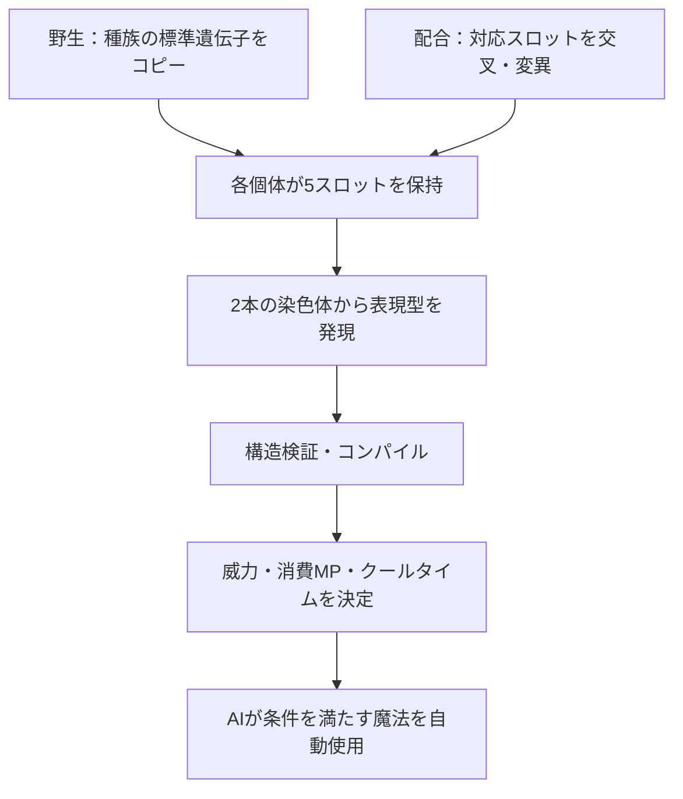

# 現在の固有魔法：生成・遺伝アルゴリズム

調査時点：2026年11月1日。実装コードと `Assets/Game/Resources/SpellSettings.asset` を基準にした説明です。過去の仕様書や構想ではなく、現在の挙動を記載します。数値や処理は今後変更される可能性があります。

## 1. 全体像

固有魔法は、固定スキルのIDではなく、複数ノードを接続した**木構造のプログラム**から作ります。1つの魔法は2本の染色体を持ち、その発現結果を実行用の命令配列に変換して使用します。



- データ上の `MagicGenome` は `SpellGenotype`、発現済みプログラムの写し、名前などを持ちます。
- `SpellGenotype` に染色体A・B、バージョン、発現時の上限、命名情報、履歴が入ります。
- 染色体はそれぞれ `SpellProgram` です。ルート、ノード、接続、対象、基礎威力、基本クールタイム、射程、調節遺伝子を持ちます。
- 親のプログラムはクローンして処理するため、配合によって親の遺伝子を書き換えません。
- `CompiledSpell` は実行用の配列で、セーブ対象ではありません。一方、`MagicGenome.expressedProgram` は保存データに含まれ得ます。ロード・準備時には遺伝子から発現結果を再計算します。

主な実装：`SpellModel.cs`、`SpellGenetics.cs`、`SpellParameterCrossover.cs`、`GeneticAlgorithm.cs`、`SpellCompiler.cs`、`SpellExecutor.cs`。

## 2. 所持スロットと初期生成

各個体は**内部的に5スロット**を持ち、各スロットが2本の染色体を持ちます。使用可能なスロット数は種族ランクで制限されます。

| ランク | 使用可能数 |
|---|---:|
| F / E | 1 |
| D / C | 2 |
| B | 3 |
| A | 4 |
| S | 5 |

使用できないスロットも保存・配合の対象です。実際の上限は `RankMagicSlotDatabase` により変更できます。

### 野生個体と卵

`WildUnitFactory.Create` は、種族の `defaultMagicGenomes` から5枠分をコピーします。種族データに有効な標準魔法がない枠は `SpeciesDefaultMagicCatalog.Create` で生成します。野生敵はランクで使用可能な枠を使います。卵は倒した個体の遺伝子を保持し、孵化時に個体のレベルを1にします。

標準魔法の生成は、系統・ランク・種族ID末尾のA/B・スロットに基づきます。概ね1枠目は系統の代表形、2枠目は状態異常、3枠目は系統に応じた回復またはバフ、4枠目は分裂、5枠目は爆発です。個別の例外として、花かぶりの1枠目は回復です。属性はパッシブの属性関連効果を優先し、なければ系統の既定属性を使います。生成後の染色体BはAの複製です。

**注意：実際の保存済み種族マスターが優先されます。** 現行の生成関数を今呼んだ結果と、過去に保存された標準魔法が必ず一致するとは限りません。`Copy` は保存済みの有効な遺伝子を優先します。

### 欠けたスロット

データに存在しないスロットは、個体IDとスロット番号から得る安定シードを用い `SpellProgramBuilder.Random` で補います。単純な弾とダメージを基礎に、属性・弾道・弾数と爆発または状態異常を選びます。存在するが無効なスロットを、配合時に黙って新しいものへ置き換える処理ではありません。

## 3. ノード、接続と対象

### ノードの種類

| 分類 | ノード | 主な役割 |
|---|---|---|
| 発動 | `PeriodicTrigger` / `EnemyNearTrigger` / `HPThresholdTrigger` | 定期・敵接近・HP閾値による発動 |
| 生成 | `SpawnProjectile` / `SplitProjectile` / `SpawnArea` | 弾、分裂弾、範囲を生成 |
| 効果 | `Damage` / `Heal` / `Explosion` | 攻撃、回復、範囲爆発 |
| 効果 | `ApplyStatus` / `ApplyBuff` / `Knockback` | 状態異常、能力上昇、押し戻し |
| 効果 | `LifeSteal` / `ManaSteal` | HP吸収、MP吸収 |
| 制御 | `Delay` / `RandomBranch` / `Conditional` / `Sequence` | 遅延、確率分岐、条件分岐、複数経路 |

弾道は直進・追尾・螺旋・波状・周回の5種類。属性は火・水・風・土・光・闇・無の7種類です。対象には近い敵、HP割合が低い敵、近い味方、HP割合が低い味方、自分、次の敵があります。

ノード共通パラメータは `count`、`speed`、`angle`、`seconds`、`radius`、`homing`、`multiplier`、`probability`、`threshold`、属性、状態異常、弾道、対象、条件、自分中心フラグ、バフ種別です。全パラメータが全種類のノードで使われるわけではありません。

### 型付き接続

入力コンテキストは `Cast`、`Hit`、`Expire`、`Kill`。出力ポートは `Next`、`OnHit`、`OnExpire`、`OnKill`、`True`、`False` です。接続先の入力コンテキストは、接続元がそのポートで出力するコンテキストと一致しなければなりません。

- ルートは `Cast` 入力の発動ノードです。発動ノードを子に置けません。
- 弾・範囲生成の `OnHit` は `Hit`、`OnExpire` は `Expire`、`OnKill` は `Kill` を渡します。
- `Damage`・`Explosion` にも撃破時の `OnKill` があります。
- 条件・確率分岐は `True` / `False` を使います。`Sequence` は `Next` / `True` / `False` を使えます。
- 例えば `Damage`、`Heal`、`ApplyStatus`、`Knockback`、`LifeSteal` は `Hit` 入力が必要です。
- 同一ノードから同じポートを重複して接続できず、循環・共有ノード・ルートから到達不能なノードは無効です。

## 4. 配合時の遺伝処理

`BreedingSystem.Breed` は子の種族を先に決め、親A・Bの**同じ番号の5スロット**から、それぞれ子の対応スロットを作ります。使用可能数の上限より後ろのスロットも処理します。

### 4.1 シード

通常の配合画面は配合ごとに新しいシードを生成します。`Breed` 内の `System.Random` はそのシードで初期化され、魔法スロットごとの交叉用シードを順番に生成します。配合情報と魔法履歴にもシードが記録されます。

同じ親データ、シード、種族・ルール・設定・アルゴリズムであれば、種族選択・遺伝子・個体値などの乱数結果を再現できます。子の個体IDはGUIDなので同一にはなりません。設定や実装の変更をまたいで同一結果になる保証はありません。

### 4.2 親ごとの配偶子生成

各親について、対応スロット内の染色体AまたはBを50%ずつ選んで基礎とし、もう一方を提供元にします。既定設定では各親の配偶子について**70%の確率で部分木交叉を試みます**。

1. 基礎側のルート以外から置換先を選ぶ。
2. 提供元から、入力コンテキストが同じルート以外のノードを選ぶ。
3. 選んだ部分木を置換し、コピー時にノードIDと接続を付け直す。
4. 構造検証に通る場合だけ採用する。候補なし・生成失敗・検証失敗なら交叉前の基礎を残す。
5. その配偶子に、後述の突然変異を試みる。

親A・Bから作った配偶子が子の染色体A・Bの元になります。70%は**交叉を試みる確率**であり、構造が実際に変化する確率ではありません。

### 4.3 ノード内部の交叉

配偶子を作った後、子の染色体同士でもパラメータを交叉します。一方の変更を他方へ連鎖させないよう、両方とも交叉前の配偶子を参照します。

- `nodeParameterCrossoverChance` の既定値は70%。プログラム全体の基礎威力・基本クールタイム・射程を混合する判定と、対応ノードごとの判定に使います。
- 対応ノードは、まずルートからのポート経路が同じで、**種類と入力型が同じ**ものを優先します。なければ同じ種類・入力型の未使用ノードから選びます。
- 数値は両親の間を乱数で線形補間し、弾数は整数へ丸めます。属性・状態異常・弾道・対象・条件・バフなどの離散値は、両親のいずれかから選びます。
- 交叉後に検証し、無効ならその一連のパラメータ変更を破棄します。種別が異なるノードの内部値を直接混ぜるわけではありません。

### 4.4 突然変異

確率は `SpellSettings` の既定値です。下記3種類は配偶子ごとに別々に判定され、同じ配偶子で複数起きることもあります。無効な変更は取り消されます。

| 種類 | 試行確率 | 内容 |
|---|---:|---|
| パラメータ変異 | 30% | 選んだノードの種類に適した項目かプログラム共通項目を変更し、成功時は調節遺伝子も再抽選 |
| ノード置換 | 12% | 1ノードの種類を列挙された種類から選び直す。入力・接続などの検証を通ったものだけ採用 |
| 構造変異 | 16% | 部分木の置換・削除、または遅延・状態異常・分裂等の追加を試す |

パラメータ変異には、弾数、速度、範囲、倍率、属性、状態異常、弾道、対象、時間、確率、追尾、角度、プログラム基礎威力、基本クールタイムが含まれます。ノードの種類に応じて使用する項目を選び、追尾性能は追尾弾の場合に限って選びます。変更が発生しない場合は最大3回試し、構造検証に通った実変更と変更なしの試行を履歴上で区別します。値は有効範囲へ制限されます。

これらの確率は「有効な回復魔法が生まれる確率」ではありません。ノード選択、入力型、検証、発現、対象選択がさらに影響します。構造変異は無制限に任意のノードを追加するわけではなく、現状の追加候補には偏りがあります。

### 4.5 子の対象補正と代替

交叉・変異の後、`ImproveOffspring` が新しい子の染色体を処理します。

1. 各生成ノードの下にある効果を調べます。さらに下の別の生成ノードは、その生成ノード自身の効果として別に調べます。
2. 回復・バフのみ、またはダメージ・状態異常などのみの経路では対象を修正します。攻撃と回復が混在する経路は多数決で一方に書き換えません。
3. 最初の `Cast` 入力の生成ノードに合わせ、プログラムの基本対象も必要に応じて修正します。
4. 調節遺伝子による発現を行い、イベントの到達可能性、確率、対象との整合性を検査します。有効な効果経路がなければ、子の種族の同じスロットの標準魔法を代替します。
5. 変更や代替は履歴に記録します。

判定は構造不正、有効経路なし、対象不一致、条件付き、有効を区別します。撃破経路の成立や確率0の分岐も調べますが、配置などすべての実戦条件を保証するものではありません。混在経路の片方が対象不一致で作用しない場合は警告します。すでに所持する個体の遺伝子は一括変更されません。

配合後は実際の消費MPと子の最大MPも比較し、使用可能スロットのMP不足を履歴に記録します。未解放スロットは現時点のMP不足だけで除外しません。現在は診断のみで、MP不足を理由とする再抽選・自動修復は行いません。

### 4.6 標準魔法への突然変異

上記の補正後、各スロットは独立に、既定**2%**で子の種族の同じ番号の標準魔法に置き換わります。2本の染色体が標準魔法のものになり、それまでの遺伝履歴と変異の記録を保持します。使用不可のスロットにも起こり、子孫に遺伝します。確率は `speciesDefaultMutationChance` で変更できます。

## 5. 2本の染色体の発現

`SpellGenetics.Express` は同じ入力に対して乱数を使わず、次のように表現型を作ります。

1. バージョンと両染色体を検証する。
2. `regulation.dominance` の大きい染色体を基礎にする。同値ならAを選ぶ。
3. 基礎側の `splice` が偽なら基礎のコピーを採用する。
4. 真なら、基礎のルート以外から `recipientIndex` で置換先を選ぶ。
5. 他方の染色体から、置換先と入力コンテキストが同じルート以外の部分木を `donorIndex` で選ぶ。
6. 部分木を1回組み込んで検証する。失敗・候補なしなら基礎のみを採用する。

インデックスは候補数で剰余を取り選択します。発現しなかった染色体も削除せず、次の配合で配偶子の基礎・提供元になり得ます。

## 6. コンパイルと性能計算

`SpellCompiler.Compile` が表現型の検証後、ノードIDを配列インデックスへ変換し、接続先を固定長の出力配列に格納します。戦闘中はこの `CompiledSpell` を使用します。

### 6.1 複雑度

概略式は次のとおりです。`P` は表現型の**遺伝子上の基礎威力**、`N` はノード数です。

```text
complexity = N × 0.4
弾・分裂ごとに += count × 0.28 + homing × 0.7
                 + P × max(0, multiplier - 1) × 0.025
爆発・範囲ごとに += radius × 0.6
状態異常ごとに += probability × seconds × 0.15
ダメージ・回復・爆発・状態異常ごとに += P × multiplier × 0.02
さらに += min(maxEvents, 推定弾数 × N) × 0.045
```

推定弾数は1から始め、各弾生成ノードの `count` を掛け、発動ごとの最大弾数で制限します。これは性能評価用の概算で、実際の命中回数そのものではありません。

### 6.2 威力・MP・クールタイム

```text
実行時の基礎威力 = 遺伝子の基礎威力 P × 2
消費MP = clamp((complexity × 0.8 + P × 0.025) × 2, 1, 250) × 1.5
```

基本時間は定期発動なら `max(baseCooldown, trigger.seconds)`、それ以外は `baseCooldown` です。

```text
クールタイム = clamp(基本時間 × (1 + complexity × 0.06) × 種別倍率, 0.1, 60)
種別倍率 = Healノードを含むなら1.8、それ以外なら0.8
```

種族パッシブの属性別MP軽減・クールタイム短縮をさらに適用した後、全魔法のクールタイムを0.8倍します。効果時間延長も生成・状態異常・バフの実行用パラメータに適用します。ただし毒・火傷の持続時間は現在固定です。**最大MPに対する消費MPの自動割引はありません。** 消費MPが最大MPを超える魔法は、その個体が現在の能力・装備で発動できません。

攻撃の基礎値は概ね `(実行時の基礎威力 + 使用者の魔法攻撃力 × 0.5) × 効果倍率 × 生成・分裂側から引き継いだ倍率` です。そこに攻撃側のバフ・種族パッシブ、敵から味方への難易度補正、対象の魔法防御と属性耐性などを適用します。防御計算では対象の防御力を2倍して使用します。回復量の計算には魔法攻撃力をそのまま使用します。

## 7. 戦闘での実行

1. 使用可能なスロットを番号順に確認する。
2. 魔法が有効で、クールタイム終了、MP足りる、沈黙していない、ルート条件成立を確認する。
3. 射程内の対象を選ぶ。味方対象の魔法では、選んだ対象に回復・バフが必要かも確認する。
4. `CastSession` を確保できたときにMPを消費し、その魔法だけのクールタイムを開始する。
5. ノードはイベントキューで処理する。弾はプールから取得し、命中・消滅時のイベントを送る。範囲効果は0.5秒間隔で作用する。

複数魔法はそれぞれ判定されます。発動中も原則移動でき、発動できる魔法がない場合は通常攻撃を試みます。味方か敵かは効果ごとに判定されるため、攻撃効果は味方に、回復効果は敵に作用しません。

### 状態異常

状態異常の付与率は、効果の基礎確率と、対象の属性状態異常抵抗・デバフ抵抗から計算します。毒は最大HPの2%/秒を10秒、火傷は5%/秒を4秒です。別種類の状態異常は同時に受けられます。複数の `ApplyStatus` ノードが発現し、各ノードが有効な敵に到達すれば、1つの魔法で複数種類を付与できます。

## 8. 安全上限

既定の `SpellSettings.asset`：

| 項目 | 既定値 |
|---|---:|
| 1プログラムのノード | 24 |
| 木の深さ | 6 |
| 1発動の累計弾数 | 48 |
| 弾の生成世代 | 3 |
| 1発動の予約イベント | 128 |
| 弾・範囲の寿命 | 6秒 |

実行時にはさらに、同時 `CastSession` 最大128、共有イベントキュー2048、処理イベント毎フレーム最大512、プール弾最大256、発動セッションの期限60秒があります。上限に達した処理は予約・生成されない場合があります。数値や列挙値にも検証範囲があり、例えば遺伝子上の基礎威力は1～500、ノードの弾数は1～48です。

## 9. 自動命名と保存

自動名は**発現したプログラム**から作ります。最初の弾・範囲生成の属性と形、弾道、回復・分裂・爆発などを調べ、`SpellNameDictionary` の特殊ルールと特徴重要度・テンプレートを使います。カスタム名があれば表示時に優先し、性能には影響しません。

ユニットのJSONには、使用可能な魔法用の `magicGenomeJson` と、5枠の遺伝用 `magicSlotGenomeJson` が保存されます。各枠に2本の染色体、ノード・接続・パラメータ、調節遺伝子、バージョン、名前、履歴が含まれます。親ID・世代・配合概要は系譜側に記録します。

## 10. 主な設定・参照先

| 内容 | ファイル |
|---|---|
| 生成上限・変異率 | `Assets/Game/Resources/SpellSettings.asset` |
| ランク別使用枠数 | `Assets/Game/Resources/RankMagicSlotDatabase.asset` |
| 標準魔法マスター | `Assets/Game/Data/Species/*.asset`、特殊種族は `Assets/Game/Resources/SpecialSpecies.asset` |
| 命名辞書 | `Assets/Game/Resources/SpellNameDictionary.asset` |
| 配合と対象補正 | `Assets/Game/Runtime/Breeding/BreedingSystem.cs`、`GeneticAlgorithm.cs` |
| 検証・発現・交叉・変異 | `Assets/Game/Runtime/Magic/Programming/SpellModel.cs`、`SpellGenetics.cs`、`SpellParameterCrossover.cs` |
| 実行・性能計算 | `SpellCompiler.cs`、`ProgramMagic.cs`、`SpellExecutor.cs` |
| プレイヤー向けプレビュー・詳細 | `Assets/Game/Runtime/UI/MagicPreviewController.cs`、`GameUIController.cs` |

設定の変更は新たに生成・コンパイルする魔法に影響します。魔法の発現や効果を実際に確認するには、種族パッシブ、MP、対象の耐性、戦闘中の位置や生存状態も合わせて確認してください。
